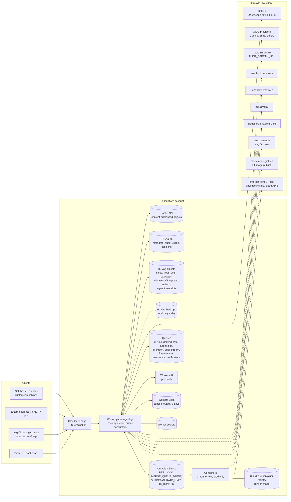

# ADR 0005: Where customer data lives (residency)

- Status: Proposed (DRAFT, not approved)
- Date: 2026-10-17
- Issue: #68 (epic #64, roadmap #23)

> DRAFT for Justin to decide. Nothing here is approved, and nothing here is a
> claim that yuma-agent-git keeps data in Australia. Until this record is
> Accepted and every row of [docs/residency.md](../residency.md) is enforced,
> no doc, page or sales material may say "Australian data residency".

## Context

Some customers will need their source, metadata, logs and backups to stay in
Australia. Today the forge runs entirely on Cloudflare: a Worker (Hono) with
D1, R2, Durable Objects, Queues, Workers AI and Containers, as declared in
`worker/wrangler.jsonc`. The full binding and external call inventory is in
[docs/residency.md](../residency.md).

What Cloudflare offers, checked against its public docs on 17 October 2026:

- **IRAP.** Cloudflare holds an IRAP assessment at PROTECTED. Its page lists
  Workers, D1, R2, Durable Objects and Containers in scope. Queues and Workers
  AI were not on the list we read; only AI Gateway was. The report itself needs
  an NDA. ([Cloudflare IRAP](https://www.cloudflare.com/cloudflare-for-government/australia/irap/))
- **Data Localization Suite regions.** The "Australia" region gives Regional
  Services (HTTPS traffic decrypted and served only in Australian data
  centres). The "IRAP Protected" region may use assessed data centres outside
  Australia. Neither has a Customer Metadata Boundary, which exists only for
  the US and the EU.
  ([region support](https://developers.cloudflare.com/data-localization/region-support/))
- **D1.** Jurisdictions are `eu`, `us` and `fedramp` only. `oc` (Oceania) is a
  location hint, best effort, set at creation with the `--location=oc` flag
  of `wrangler d1 create`; a jurisdiction cannot be added later.
  ([D1 data location](https://developers.cloudflare.com/d1/configuration/data-location/))
- **R2.** Same jurisdictions (`eu`, `us`, `fedramp`). `oc` is a best effort
  hint, applied only when a bucket name is first created; jurisdictions cannot
  be changed after creation.
  ([R2 data location](https://developers.cloudflare.com/r2/reference/data-location/))
- **Durable Objects.** Same jurisdictions. `locationHint: 'oc'` is passed to
  `namespace.get(id, { locationHint })`, is best effort, and only the first
  `get()` of an object counts; objects do not move afterwards.
  ([Durable Objects data location](https://developers.cloudflare.com/durable-objects/reference/data-location/))
- **Workers Logs.** Kept 7 days on the paid plan, "written to your Cloudflare
  account"; the docs say nothing about where.
  ([Workers Logs](https://developers.cloudflare.com/workers/observability/logs/workers-logs/))
- **Artifacts.** No documented location or jurisdiction controls. The forge
  does not use Artifacts today (ADR 0001 keeps it as a fallback only).

So on Cloudflare today data at rest can be **hinted** to Oceania, but not
**guaranteed** to stay in Australia. Oceania is also wider than Australia.

What the code does today (17 October 2026, local `main`):

- No `--location` on the D1 or R2 create commands in `docs/deploy.md`, and no
  `locationHint` or `jurisdiction` anywhere in `worker/src`. The production
  database `yag-db` and bucket `yag-objects` already exist; where Cloudflare
  placed them is not recorded in this repo.
- R2 blobs are stored as plaintext content (zstd compressed) under their
  SHA-256 address (`worker/src/core/blobs.ts`). Only CI secrets
  (`worker/src/secrets/crypto.ts`), TOTP seeds (`worker/src/auth/totp.ts`) and
  backup parts (`worker/src/backup/backup.ts`) are encrypted with keys Yuma
  holds as Worker secrets.
- Agents call Workers AI (`worker/src/agents/llm.ts`) with prompts that hold
  repository content. There is no per-org switch to turn this off.
- Production has no backup bucket bound yet (`docs/operations/backup-dr.md`).
- The deployment is on `workers.dev`, which is a Cloudflare-owned zone, so
  Regional Services cannot apply to it. A custom domain is needed for that.

## Data flow

Every store (boxes with a cylinder shape) and every log sink in the current
code. Dashed lines are optional or configured per deployment.

## Options

### 1. Cloudflare with Oceania hints, Regional Services and Yuma-held keys

Stay on Cloudflare. Create new D1 and R2 resources with `--location oc` (the
existing ones cannot be moved), pass `locationHint: 'oc'` on every Durable
Object `get()`, put the forge on a custom domain with Regional Services set to
Australia, encrypt R2 blob content with keys Yuma holds (envelope encryption in
`worker/src/core/blobs.ts`, address still the SHA-256 of plaintext), and block
Workers AI and other external model calls for orgs that require residency.

Guarantees: HTTPS for the custom domain is decrypted and served only in
Australian data centres (Regional Services). A copy of blob content that lands
outside Australia is ciphertext, provided the key never leaves the Worker
secret store. Does **not** guarantee: where D1 rows, Durable Object state,
Queue messages, Workers Logs, Cloudflare account metadata or Cache API entries
sit at rest; Oceania is not Australia; hints are best effort and placement can
change. D1 metadata (issue titles, commit messages, paths, user emails) stays
plaintext. Queues and Workers AI are not in the IRAP service list we read.

### 2. A self-hostable edition on Australian infrastructure

Package the forge to run on Australian IaaS (an Australian sovereign cloud or
AWS Sydney) for customers who need guaranteed residency. ADR 0001 dropped the
Forgejo path, so this means a portable core: the Worker code on `workerd` or
Node, with D1, R2, Durable Objects, Queues and Containers replaced by portable
equivalents (for example Postgres, S3-compatible storage, a lock service, a
queue and a container runtime). Each store sits behind a seam today only in
part (`worker/src/db/client.ts`, `worker/src/core/blobs.ts`).

Guarantees: every store, log and backup is in a region the customer or Yuma
chooses, and the provider's contract can say Australia. Does **not**
guarantee anything by itself about outbound calls (GitHub, IdPs, webhooks,
email, OSV), which still go where the customer points them. Cost: the largest
build effort of the three, and a second deployment shape to test and support.

### 3. Split: Australian data stores, Cloudflare at the edge only

Keep the Worker on Cloudflare for routing and TLS (with Regional Services), but
move metadata and object storage to Australian infrastructure: Postgres in an
Australian region (reached through Hyperdrive or a private tunnel) in place of
D1, and S3-compatible Australian object storage in place of R2. Durable
Objects, Queues and Containers either stay (and keep their residency gap) or
move with the stores.

Guarantees: data at rest in the moved stores is in Australia. Does **not**
guarantee: anything held by the parts left on Cloudflare (Durable Object
state, queue payloads, Workers Logs, Cache API, CI workspaces), and every
request now crosses from the edge to the Australian stores, which adds latency
and a new network path to secure. Hyperdrive query caching would need to be
off or checked for where it caches. Cost: large, and it gives up the property
ADR 0001 chose the current core for (one store close to the Worker).

## Scoring

| Criterion                             | 1. Cloudflare hints + keys                          | 2. Self-hosted edition               | 3. Split stores               |
| ------------------------------------- | --------------------------------------------------- | ------------------------------------ | ----------------------------- |
| Data at rest guaranteed in Australia  | No (hints only; blobs ciphertext)                   | Yes, if the host contract says so    | Only for moved stores         |
| Edge processing in Australia          | Yes, with Regional Services on a custom domain      | Yes                                  | Yes, with Regional Services   |
| Metadata (D1) in Australia            | Hint only                                           | Yes                                  | Yes                           |
| Logs in Australia                     | Not documented                                      | Yes                                  | Not documented (Workers Logs) |
| Build effort                          | Small to medium (new resources, encryption, gating) | Largest (portable stores)            | Large                         |
| Fits ADR 0001 (one store, Scion core) | Yes                                                 | Needs seams; same core logic         | Weakens it                    |
| Operating cost                        | Lowest (current platform)                           | Highest (servers, patching, on-call) | Medium to high                |
| IRAP inheritance                      | Cloudflare report covers most services              | Depends on the IaaS provider's IRAP  | Mixed                         |

Sources: the Cloudflare pages linked in Context, read 17 October 2026.

## Recommendation (not a decision)

1. Take option 1 now for Yuma's own use and for customers who are content with
   "Australia preferred": new `oc` hinted resources, Regional Services on a
   custom domain, blob encryption with Yuma-held keys, Workers AI gated by a
   per-org setting. Write the residual risk into the customer agreement in
   plain words.
2. Do not offer "Australian data residency" on Cloudflare. Offer an
   `au_required` tier only through option 2, and build option 2 only when a
   customer who needs it is signed, because it is the largest piece of work.
3. Do not take option 3. It costs nearly as much as option 2 and still leaves
   Durable Objects, Queues and logs unresolved.
4. Ask Cloudflare (under NDA, with the IRAP report) where D1, Durable Objects,
   Queues, Workers Logs and account metadata are stored for an Australian
   account, and whether an Oceania or Australian jurisdiction is planned. A
   jurisdiction for `au` would change this record.

## Decision

Pending. Justin decides. This record stays Proposed until then, and the
ticket's rule holds: no production customer data is stored before it is
Accepted.

## Consequences (if the recommendation is taken)

- New production D1 and R2 resources with `--location oc`, and a data
  migration from `yag-db` and `yag-objects`. This touches production and needs
  Justin's go-ahead first.
- `docs/deploy.md` changes its create commands to pass `--location oc`.
- Every `namespace.get(id)` call gains `{ locationHint: 'oc' }`; existing
  objects keep their current placement.
- `worker/src/core/blobs.ts` gains envelope encryption; content addressing
  stays the SHA-256 of plaintext and ciphertext is stored separately.
- A per-org `residency` setting (`au_required`, `au_preferred`, `none`) and a
  `residency_restricted` error for blocked features (Workers AI, outbound
  integrations as Justin chooses).
- A backup bucket with an `oc` hint, or an S3-compatible Australian bucket,
  before production backups start.

## Review triggers

- Cloudflare adds an Australian or Oceania jurisdiction for D1, R2 or Durable
  Objects, or a Customer Metadata Boundary for Australia.
- Cloudflare's IRAP scope changes (for example Queues or Workers AI are added).
- A customer signs who needs guaranteed residency (triggers option 2).
- The forge starts using Cloudflare Artifacts (ADR 0001 fallback).

## Decisions for Justin

- Which option (1, 2, 3 or a mix) to accept, and whether the recommendation
  above is the direction.
- Whether to recreate the production D1 database and R2 bucket with
  `--location oc` and migrate the data, and when.
- Whether to move the forge from `workers.dev` to a custom domain so Regional
  Services (Australia) can apply.
- Which features an `au_required` org loses: Workers AI only, or also GitHub
  import, mirrors, webhooks, audit streaming and email to non-Australian
  endpoints.
- Where blob encryption keys live and how they rotate (Worker secret like
  `SECRETS_KEK`, or an external key service).
- Whether to ask Cloudflare for the IRAP report under NDA and for written
  answers on where D1, Durable Objects, Queues, logs and account metadata live.
- What wording, if any, sales and docs may use about location before this
  record is Accepted.
