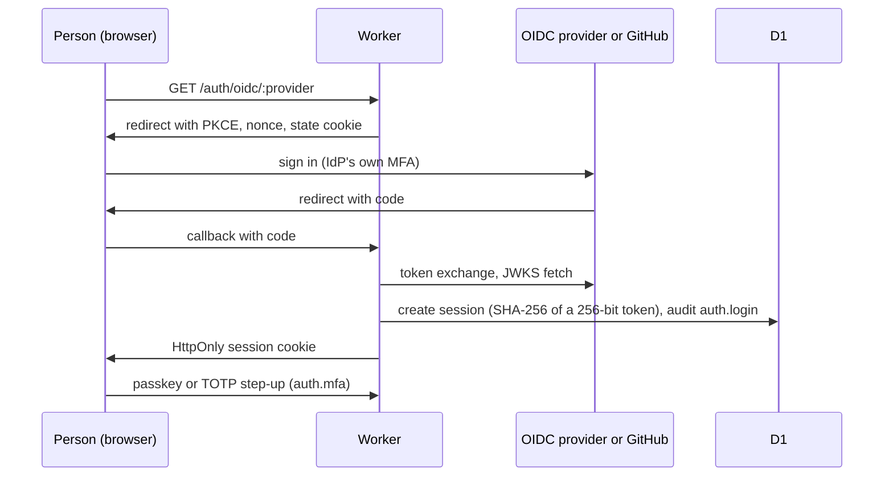
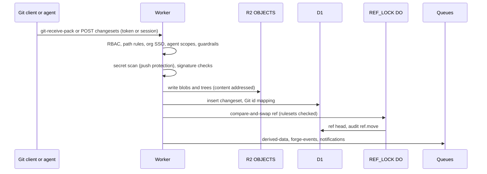
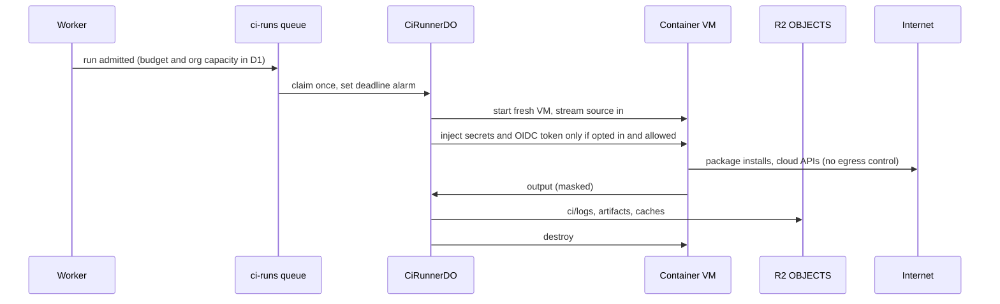
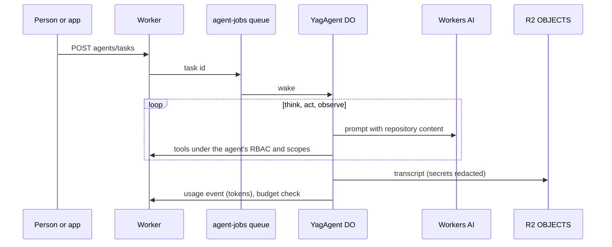

# Data flows (DRAFT)

> DRAFT readiness material for issue #69, not approved. **IRAP-experienced
> reviewer: pending.** Locations are as described in
> [docs/residency.md](../../residency.md); nothing here claims data stays in
> Australia.

The overall picture of every store and log sink is in
[ADR 0005](../../adr/0005-residency.md#data-flow). The flows below show the
main paths one at a time, with the trust boundary each crosses. Code paths are
under `worker/src/`.

## 1. Sign-in

Code: `auth/oidc.ts`, `auth/oauth.ts`, `auth/session.ts`, `auth/webauthn.ts`,
`auth/totp.ts`. Crosses: internet to Cloudflare edge; Worker to IdP.

## 2. Git push and commit

Code: `git/receive-pack.ts`, `core/commit.ts`, `core/refdo.ts`,
`security/secrets/scan.ts`, `policy/rulesets.ts`.

## 3. CI job

Code: `ci/runs.ts`, `ci/runner.ts`, `ci/inject.ts`, `ci/mask.ts`. Self-hosted
runners pull jobs over HTTPS instead and run on customer machines
(`ci/runners.ts`, `docs/runner-protocol.md`).

## 4. Agent task

Code: `agents/runtime.ts`, `agents/llm.ts`, `agents/tools.ts`,
`usage/record.ts`.

## 5. Outbound integrations

| Flow                  | From                             | To                        | Payload                      | Guard                                            |
| --------------------- | -------------------------------- | ------------------------- | ---------------------------- | ------------------------------------------------ |
| Webhooks              | `webhooks/deliver.ts`            | Customer URL              | Domain events                | HTTPS, private addresses refused, HMAC signature |
| Audit stream          | `audit/stream.ts`                | `AUDIT_STREAM_URL`        | Audit events                 | HTTPS, HMAC signature                            |
| Email                 | `notify/email.ts`                | PaperBoy or Email Routing | Notification text            | Signed unsubscribe links                         |
| Mirrors               | `mirrors/remote.ts`              | Any Git host              | Repository content in or out | Private addresses and redirects refused          |
| GitHub import, export | `bridge/`, `git/fetch-client.ts` | GitHub                    | Repository content in or out | Admin started, App permissions                   |
| Advisories            | `security/deps/osv.ts`           | `api.osv.dev`             | Package names and versions   | `OSV_SYNC=off` stops it                          |

## Decisions for Justin

- Whether these diagrams are enough for an assessor, or whether a formal data
  flow diagram per classification level is needed.
- Whether outbound integrations should be listed per org in the product, so a
  customer can see where its data goes.
